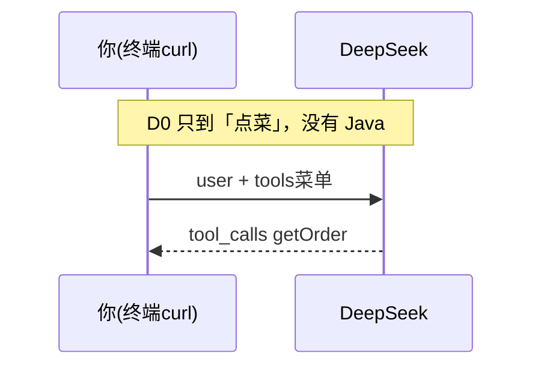

# 阶段 2：Function Calling / Tool Use（整合学习文档 · 新手逐步版）

> 业余约 10～11 天 | **只读这一份**。每天按 **「今日路线 → 逐步操作（D*-O*）→ 成功长什么样 → 完成判定」** 从上往下做，不要跳节。
> 任务总表：[learning-plan.md 阶段 2](learning-plan.md) · 博客清单：[resources.md#stage-2](resources.md#stage-2)

---

## 新手：本文档怎么读（先看这一节）

你不需要同时打开别的文件。**知识（原 K1–K20）、操作步骤、实验记录表（§9）都在本文。**

### 每一天固定结构

| 块                     | 你要做什么                                                                                        |
| ---------------------- | ------------------------------------------------------------------------------------------------- |
| **今日路线**     | 5 条以内：今天写不写代码、用几个终端、要不要开 IDE                                                |
| **必读资料**     | 只打开当天列出的**1～2 篇链接**（官方或博客），看完立刻做下面的步骤，不要自己搜教程         |
| **必知**         | 勾选`- [ ]`，表示「我读懂了」；不懂先做完「逐步操作」再回来勾                                   |
| **逐步操作**     | 按**D0-O1、D0-O2…** 顺序做；**不要跳步**。每步先看 **为什么**，再照命令做      |
| **成功长什么样** | 对照 JSON / 日志 / 浏览器，和下面示例一致才算过                                                   |
| **完成判定**     | 当天全部打勾，才能进下一天                                                                        |
| **填 §9**       | 告诉你要填表格**哪一行**；表格在本文 **最底部**（编辑器里搜索 `§9 对照实验` 跳转） |

### 两种终端（整阶段都这样）

| 终端             | 什么时候开 | 干什么                                                                 |
| ---------------- | ---------- | ---------------------------------------------------------------------- |
| **终端 1** | D1 起每天  | `cd demos/backend && mvn spring-boot:run`，占着不要关，看到 `8080` |
| **终端 2** | 做实验时   | 执行**curl** 或看 Key；**D0 只需要终端 2**（不启动 8080）  |

### 三种动手标签

| 标签                   | 含义                                                        |
| ---------------------- | ----------------------------------------------------------- |
| **【不写代码】** | 只终端 + 读文档，不改 Java                                  |
| **【调用后端】** | 8080 已启动，只 curl，不改`stage02` 源码                  |
| **【写后端】**   | 必须用 IDE 改`demos/backend/.../stage02/`，改完重启终端 1 |

### 和阶段 1 的关系

阶段 1 教「怎么跟模型说话」；阶段 2 教「模型点菜、Java 下厨查真实数据」。**建议**至少做过阶段 1 的 Day 5（`.entity()` + `ChatClient`），否则 D1 会懵。没做完也可以做 D0，D1 再补阶段 1。

**§9 实验记录在哪**：滚动到本文末尾 **[§9 对照实验记录](#sec-s9)**，每做完一步就把现象填进对应行（日期、耗时、一句话即可）。

---

## 进阶段 2 前 1 分钟自查

- [X] 项目根目录有 `.env` 或终端里能 `echo $DEEPSEEK_API_KEY` 看到 sk- 开头（没有就去 [DeepSeek 控制台](https://platform.deepseek.com/api_keys) 申请）
- [X] 本机已装 JDK 21（终端：`export JAVA_HOME=$(/usr/libexec/java_home -v 21)` 后 `java -version` 显示 21）
- [ ] 知道仓库路径：`ai-agent-study/demos/backend` 是 Java 后端（和阶段 0/1 **同一个** Maven 工程）

---

## 代码写在哪、前端要不要开

| 组件      | 磁盘路径                                                   | 新手怎么打开                                                    |
| --------- | ---------------------------------------------------------- | --------------------------------------------------------------- |
| Java 后端 | `demos/backend/src/main/java/com/example/demos/stage02/` | IDE 左侧按包展开`stage02`（**D1 才建这个文件夹**）      |
| 对照样板  | `.../stage01/controller/PromptExperimentController.java` | D1 不会写时可打开看`ChatClient` 怎么注入                      |
| Vue 前端  | `demos/frontend`                                         | **D0～D9 可以不启动**；菜单 Function Calling 目前是占位页 |
| 实验说明  | `demos/02-tool-use/README.md`                            | 可选，D10 加分再看                                              |

**D1 起启动后端（终端 1，占着别关）**：

```bash
cd /Users/adjikly/学习工作/个人文件/ai/ai-agent-study   # 换成你的仓库根目录
export JAVA_HOME=$(/usr/libexec/java_home -v 21)
cd demos/backend && mvn spring-boot:run
```

看到日志里有 **Tomcat started on port 8080** 再继续。Key 报错：检查根目录 `.env` 里 `DEEPSEEK_API_KEY=`。

**接口一览（按天别调错）**

| 何时可用     | 调谁                                    | 方法 | 完整地址 / 路径                                                                                                     |
| ------------ | --------------------------------------- | ---- | ------------------------------------------------------------------------------------------------------------------- |
| **D0** | **DeepSeek 云端**（不经过本仓库） | POST | `https://api.deepseek.com/chat/completions`，body 用仓库里的 `demos/02-tool-use/d0-tool-calls.json`（见 D0-O2） |
| D1+          | 本机 Spring Boot（`:8080`）           | GET  | `http://localhost:8080/api/stage/02/store` 看内存假订单（**D1 写完 Java 才有**）                            |
| D1+          | 本机 Spring Boot                        | POST | `http://localhost:8080/api/stage/02/chat`，body：`{"question":"..."}`（Q1/Q2/Q3 从这里进）                      |
| D6+          | 本机 Spring Boot                        | POST | `http://localhost:8080/api/stage/02/chat-lc4j` LangChain4j 对照                                                   |

**D0 别调错**：今天**没有** `localhost:8080`，也**没有** Java 里的 `getOrder`；只调上一行 DeepSeek 地址。

---

## 什么时候写代码（别记混）

| 天           | 写 Java？                    | 今天结束时你应该能演示什么                                          |
| ------------ | ---------------------------- | ------------------------------------------------------------------- |
| **D0** | 否                           | curl DeepSeek 一次，响应里有`tool_calls`，**没有**真实 PAID |
| **D1** | **是（第一天写代码）** | Q1 问订单，8080 返回「已支付」                                      |
| D2           | 是（只加日志）               | 控制台有`[tool] getOrder`                                         |
| D3～D6       | 是                           | 多工具 / Trace / 校验 / LangChain4j                                 |
| D7～D9       | 否（只 curl）                | 对照、缓存、失败模式                                                |
| D10          | 否                           | §9 填完 + 总计划打勾                                               |

---

## 固定夹具（11 天不要改成天气 Demo）

后面所有 **Q1 / Q2 / Q3** 都指下面三句话（复制到 curl 的 `question` 里）：

| 简称         | 复制这一整句                                    |
| ------------ | ----------------------------------------------- |
| **Q1** | `ORD-1001 现在什么状态？`                     |
| **Q2** | `SKU-88 在 WH-A 还有多少库存？`               |
| **Q3** | `ORD-1001 能不能发货？先查订单再查对应库存。` |

内存假数据（D1 的 `OrderStore` 会写死这些）：ORD-1001 状态 **PAID**；SKU-88 @ WH-A 库存 **10**。

---

## 博客与官方文档（按天打开，不要全刷）

| 天      | 必读（打开链接 → 看完立刻做当天 O 步骤）                                                                                                                                                                |
| ------- | -------------------------------------------------------------------------------------------------------------------------------------------------------------------------------------------------------- |
| D0      | [DeepSeek Tool Calls 官方](https://api-docs.deepseek.com/zh-cn/guides/tool_calls) — 侧边栏 **API Guides → Tool Calls**；只看 `tools` / `tool_calls`（旧链接 `.../function_calling` 已失效） |
| D1      | [Spring AI Tool Calling 官方](https://docs.spring.io/spring-ai/reference/api/tools.html) — 搜 `@Tool`、`.tools(`；卡住再看 [中文镜像](https://springdoc.cn/spring-ai/api/tools.html)                  |
| D1 可选 | [腾讯云 Tool Calling 实战](https://cloud.tencent.com/developer/article/2649974) — **只看** `@Tool` + `.tools()`，场景仍用本仓库订单                                                            |
| D2      | 无新链接 — 继续用 D1 的 Spring AI Tool 文档，今天只看日志                                                                                                                                               |
| D3      | [掘金 · 工具调用循环](https://juejin.cn/post/7626969207809556520) — 只看「框架控制的工具执行」                                                                                                          |
| D4      | 同上掘金 — 对照多轮 Trace                                                                                                                                                                               |
| D5      | [DeepSeek Tool Calls — strict](https://api-docs.deepseek.com/zh-cn/guides/tool_calls) — 页内 **strict 模式（Beta）**（**不要改**项目 base-url）                                             |
| D6      | [LangChain4j Tools](https://docs.langchain4j.dev/tutorials/tools/) + [AiServices](https://docs.langchain4j.dev/tutorials/ai-services)                                                                      |
| D7      | [resources.md#stage-2](resources.md#stage-2) — 扫一眼「Spring AI vs LangChain4j」对比表                                                                                                                  |
| D8      | [DeepSeek Context Caching](https://api-docs.deepseek.com/zh-cn/guides/kv_cache)                                                                                                                           |
| D9      | 无新链接 — 用本文 D9 四问法 + 终端 1 日志                                                                                                                                                               |
| D10     | 无新链接 — 填 §9 +[learning-plan.md](learning-plan.md)                                                                                                                                                  |

更多链接见 [resources.md#stage-2](resources.md#stage-2)。

---

## 总进度（给 learning-plan 打勾用）

| 总计划 | 做完哪几天 | 必勾 K      |
| ------ | ---------- | ----------- |
| S2-T1  | D0         | K1–K4      |
| S2-T2  | D1 D2 D3   | K5–K8      |
| S2-T3  | D6         | K14 K15     |
| S2-T4  | D3 D4 D9   | K8–K11 K19 |
| S2-T5  | D7 D10     | K16 K20     |
| S2-T6  | D5         | K12 K13     |
| S2-T7  | D8         | K17 K18     |

---

## D0 · 直连 DeepSeek 看点菜（约 45 分钟）`【不写代码】`

**对应** S2-T1 · **K1–K4** · **不启动 8080**、**不写 stage02**。

### 今天是为了学啥

阶段 2 的核心是：**大模型不会替你查订单库**，它只能根据你提供的「工具菜单」决定「该调哪个函数、参数是什么」，并以 JSON 形式返回（`tool_calls`）。**真正查库、得到 PAID，是 D1 写 Java 之后的事。**

D0 只做一件事：用和阶段 0 一样的 **curl 调 DeepSeek**，但请求里多带一个 `tools` 数组（菜单里写了一个叫 **`getOrder`** 的假工具——名字是我们起的，像 OpenAPI 里的 operationId，**今天没有任何代码去实现它**）。你看一眼响应就能建立直觉：

| 你在请求里做了什么                            | 模型会做什么                                                         | 模型**不会**做什么                                                         |
| --------------------------------------------- | -------------------------------------------------------------------- | -------------------------------------------------------------------------------- |
| 用户问「ORD-1001 状态」+ 菜单里有`getOrder` | 返回`tool_calls`：`name=getOrder`，`arguments` 含 `ORD-1001` | 不会去查 MySQL/内存 Store，所以**不应**在 D0 响应里出现真实 **PAID** |

D1 起你会写 `@Tool getOrder`，调 `http://localhost:8080/api/stage/02/chat`，Spring 才会「点菜 → 执行 Java → 再问模型」。

### 今天调哪个接口

就 **一个**：

- **POST** `https://api.deepseek.com/chat/completions`
- Header：`Authorization: Bearer $DEEPSEEK_API_KEY`（Key 在仓库根 `.env`）
- Body：仓库文件 `demos/02-tool-use/d0-tool-calls.json`（已写好 user 问题 + `getOrder` 菜单，避免在终端里手敲大段 JSON）

### 今日路线

1. 终端 2：**D0-O1** 加载 Key → **D0-O2** 一条 curl → **D0-O3** 在 JSON 里确认字段 → **D0-O4** 填 §9 → **D0-O5** 勾 K1–K4。
2. 对照 [DeepSeek Tool Calls 官方](https://api-docs.deepseek.com/zh-cn/guides/tool_calls) 里的 `tools` / `tool_calls` 字段名（只看这一节，D5 再读 strict）。

### 必读资料

- [DeepSeek Tool Calls（官方）](https://api-docs.deepseek.com/zh-cn/guides/tool_calls)
  正文找 `tools` 与响应里的 `tool_calls`。若打开是「Your First API Call」，说明 URL 错了。

### 必知（读完后勾）

- [ ] **K1** 模型只返回「要调 `getOrder`、参数 ORD-1001」（`tool_calls`），**不查库**；`getOrder` 是请求 JSON 里的工具名，不是本机接口。PAID 要等 D1 Java 执行工具后才有。
- [ ] **K2** 完整链路：菜单 → 模型点菜 → **Java 执行** → 结果回传 → 模型总结。D1 起 Spring 自动循环；D0 只到「点菜」。
- [ ] **K3** 菜单 = JSON Schema：`name`、`description`、`parameters`（见 `d0-tool-calls.json`）。
- [ ] **K4** 响应里：`finish_reason` 为 `tool_calls`；`arguments` 是字符串 `{"orderId":"ORD-1001"}`。



### 逐步操作

- [X] **D0-O1** `【不写代码】` 打开终端，进入仓库根目录，检查 Key 是否存在。

  **为什么：** 下一步 curl 的 `Authorization` 读的是**当前这个终端**里的环境变量。新开的窗口不会自动带上 IDE 里的变量；先 `source .env`，是为了让这一次会话能带上 Key，同时不用把 `sk-` 明文写进 curl 命令（避免进 shell 历史）。

```bash
cd /Users/adjikly/学习工作/个人文件/ai/ai-agent-study   # 改成你的路径
set -a && [ -f .env ] && source .env && set +a
test -n "$DEEPSEEK_API_KEY" && echo "key ok" || echo "失败：根目录 .env 写 DEEPSEEK_API_KEY=sk-xxx，或 export DEEPSEEK_API_KEY=..."
```

若显示「失败」：在项目根建 `.env` 一行 `DEEPSEEK_API_KEY=你的key`（已在 `.gitignore`），或在当前终端 `export DEEPSEEK_API_KEY=...`。

- [X] **D0-O2** `【不写代码】` 在仓库根目录执行（**就是调 DeepSeek，不是 8080**）。

  **为什么：** 故意不经过 Spring。如果一上来就打 `localhost:8080`，回答里的「已支付」你分不清是模型编的，还是 Java 查出来的。这一步把链路切在「点菜」处，后面 D1 才能和今天的 JSON 对照。请求体放在文件里，是为了菜单字段和官方文档一一对应，避免在终端里手敲 JSON 漏掉 `tools`。

```bash
cd /Users/adjikly/学习工作/个人文件/ai/ai-agent-study   # 改成你的路径
set -a && [ -f .env ] && source .env && set +a
curl -sS https://api.deepseek.com/chat/completions \
  -H "Content-Type: application/json" \
  -H "Authorization: Bearer $DEEPSEEK_API_KEY" \
  -d @demos/02-tool-use/d0-tool-calls.json
```

终端应输出一长串 JSON。想看清结构可打开 `demos/02-tool-use/d0-tool-calls.json` 对照「请求里菜单长什么样」。无输出或 `401`：重做 D0-O1。

- [X] **D0-O3** `【不写代码】` 在终端输出里 **搜索**（Cmd+F）这三个词。

  **为什么：** 三个词各证明一件事：`finish_reason=tool_calls` 表示模型停在「要调函数」，还没给最终答案；`getOrder` 表示它选了菜单里的那一把；`ORD-1001` 表示参数是从用户那句话里抽出来的。同时确认没有 `PAID`，是为了把「点菜」和「事实」分开——今天没有任何代码去查订单。

  1. `finish_reason` → 值应是 **`tool_calls`**（表示模型想调工具，还没给最终答案）
  2. `getOrder` → 工具名
  3. `ORD-1001` → 应在 `arguments` 附近

  **同时确认**：整段输出里 **没有** `"PAID"` 或 `"status":"PAID"`。有 PAID 说明模型在瞎编（D0 我们根本没执行查库）。
- [X] **D0-O4** `【不写代码】` 打开本文底部 **[§9](#sec-s9)**，填 **第一行「直连 / 未执行 Tool」**。

  **为什么：** 这行是后面 10 天的基线。D1 答出 PAID 时，你要能翻回来对比「同一问题，没执行工具时长什么样」。不记下来，过两天只记得结论，记不住证据。

  - 「调了哪把」写：`无，仅有 tool_calls`
  - 「一句话现象」写：`arguments=...` 原文摘一句
- [X] **D0-O5** `【不写代码】` 回到本节「必知」，把 K1–K4 全部勾上。

  **为什么：** 勾选表示你能用自己的话讲清「模型不查库」。总计划里 S2-T1 打勾的条件是 D0 和 K1–K4 都完成，不是 curl 通了就行。

### 成功长什么样（对照终端 JSON）

合格片段示例：

```json
"finish_reason": "tool_calls",
"tool_calls": [{
  "function": {
    "name": "getOrder",
    "arguments": "{\"orderId\":\"ORD-1001\"}"
  }
}]
```

常见错误：

| 现象                                     | 可能原因            | 处理                                                 |
| ---------------------------------------- | ------------------- | ---------------------------------------------------- |
| `401`                                  | Key 未加载          | D0-O1 里`source .env`                              |
| 只有散文`content`、没有 `tool_calls` | 请求体没带`tools` | 确认用了`-d @demos/02-tool-use/d0-tool-calls.json` |
| 响应里有 PAID                            | 模型幻觉            | 有`tool_calls` 仍算 D0 过关；§9 备注              |

### D0 完成判定

- [X] D0-O1～O5 全部做过
- [X] 见过 `tool_calls` + ORD-1001，且理解「此时没有 Java 查库」
- [X] §9 第一行已填；K1–K4 已勾

**明天 D1**：第一次在 IDE 里建 `stage02` 包并写 `@Tool`。**今天不要建 stage02。**

---

## D1 · 第一个 `@Tool` + `/chat` `【写后端 · 里程碑】`

**对应** S2-T2 · **K5 K6** · 今天 **第一次写 Java**。

### 今日路线

1. IDE 打开 `demos/backend`，在 `stage02` 包下 **新建 5 个 Java 文件**（下面有全文可复制）。
2. **终端 1** 启动 `mvn spring-boot:run`（占着）。
3. **终端 2** 用 curl 调 `POST /api/stage/02/chat`。
4. 先读 10 分钟官方文档，再粘贴代码（链接见上文「博客与官方文档」D1 行）。

### 必读资料

1. [Spring AI Tool Calling](https://docs.spring.io/spring-ai/reference/api/tools.html) — 页面内 **Ctrl+F 搜 `@Tool`**，看 Quick Start 那段「`.tools(new DateTimeTools())`」。
2. 卡住再看 [中文镜像 · 工具调用](https://springdoc.cn/spring-ai/api/tools.html) 同一节。

### 必知（读完后勾）

- [X] **K5** 工具注解是 **`org.springframework.ai.tool.annotation.Tool`**（LangChain4j 的包名不同，D6 才用）。
- [X] **K6** 关键一行：`.tools(orderQueryTools)` — 没这行，模型看不到菜单，会瞎编订单状态。

### 在 IDE 里怎么建文件（逐步）

包路径必须是（和 stage00、stage01 同级）：

```text
demos/backend/src/main/java/com/example/demos/stage02/
├── api/OrderRecord.java
├── api/ToolChatRequest.java
├── store/OrderStore.java
├── tool/OrderQueryTools.java
└── controller/Stage02ToolController.java
```

**操作方式（IntelliJ 示例）**：

1. 在项目树展开 `demos/backend/src/main/java/com/example/demos/`。
2. 若没有 `stage02`：右键 `demos` → New → Package → 输入 `com.example.demos.stage02.api`（IDE 会建 `stage02/api`）。
3. 右键 `stage02.api` → New → Java Class → 粘贴下面 **OrderRecord** 全文 → Save。
4. 对其余 4 个文件重复（注意 `store`、`tool`、`controller` 子包）。

**对照**：可并排打开 `stage01/controller/PromptExperimentController.java`，看 `ChatClient` 是怎么构造的；阶段 2 多一个 `.tools(...)`。

### 逐步操作（代码 + 验证）

- [X] **D1-O1** `【写后端】` 创建下面 5 个文件（**逐文件复制**，package 行不要改错）。

  **为什么：** 五个类按你熟悉的分层拆开，后面每天只改一层：`OrderRecord` 是一行订单的 DTO；`OrderStore` 是内存里的「表」（相当于还没接 MySQL 的 Mapper）；`OrderQueryTools` 是模型可以点的业务方法；`ToolChatRequest` 是 HTTP 入参；`Stage02ToolController` 是入口。挤在一个类里，D3 加库存、D6 加第二套框架时会互相踩。

```java
// api/OrderRecord.java
package com.example.demos.stage02.api;

public record OrderRecord(
        String orderId, String userId, String sku, int qty, String status, String warehouse) {}
```

```java
// store/OrderStore.java
package com.example.demos.stage02.store;

import com.example.demos.stage02.api.OrderRecord;
import java.util.Map;
import java.util.Optional;
import java.util.concurrent.ConcurrentHashMap;
import org.springframework.stereotype.Component;

@Component
public class OrderStore {
    private final Map<String, OrderRecord> orders = new ConcurrentHashMap<>();

    public OrderStore() {
        put(new OrderRecord("ORD-1001", "U001", "SKU-88", 2, "PAID", "WH-A"));
        put(new OrderRecord("ORD-1002", "U002", "SKU-88", 1, "CANCELLED", "WH-A"));
        put(new OrderRecord("ORD-1003", "U001", "SKU-99", 5, "PAID", "WH-A"));
    }

    private void put(OrderRecord row) { orders.put(row.orderId(), row); }

    public Optional<OrderRecord> findById(String orderId) {
        return Optional.ofNullable(orders.get(orderId));
    }

    public Map<String, OrderRecord> snapshot() { return Map.copyOf(orders); }
}
```

```java
// tool/OrderQueryTools.java
package com.example.demos.stage02.tool;

import com.example.demos.stage02.store.OrderStore;
import com.fasterxml.jackson.core.JsonProcessingException;
import com.fasterxml.jackson.databind.ObjectMapper;
import java.util.Map;
import org.springframework.ai.tool.annotation.Tool;
import org.springframework.ai.tool.annotation.ToolParam;
import org.springframework.stereotype.Component;

@Component
public class OrderQueryTools {
    private final OrderStore orderStore;
    private final ObjectMapper objectMapper;

    public OrderQueryTools(OrderStore orderStore, ObjectMapper objectMapper) {
        this.orderStore = orderStore;
        this.objectMapper = objectMapper;
    }

    @Tool(description = "按订单号查询订单。orderId 必须形如 ORD-数字，例如 ORD-1001。只能查订单，不能查库存数量。查不到返回 not_found，不要猜测。")
    public String getOrder(@ToolParam(description = "订单号，例如 ORD-1001") String orderId) {
        return orderStore.findById(orderId)
                .map(this::toJson)
                .orElseGet(() -> toJson(Map.of("error", "not_found", "orderId", orderId)));
    }

    private String toJson(Object value) {
        try {
            return objectMapper.writeValueAsString(value);
        } catch (JsonProcessingException e) {
            return "{\"error\":\"serialize_failed\"}";
        }
    }
}
```

```java
// api/ToolChatRequest.java
package com.example.demos.stage02.api;

public record ToolChatRequest(String question) {}
```

```java
// controller/Stage02ToolController.java
package com.example.demos.stage02.controller;

import com.example.demos.stage02.api.ToolChatRequest;
import com.example.demos.stage02.store.OrderStore;
import com.example.demos.stage02.tool.OrderQueryTools;
import java.util.Map;
import org.springframework.ai.chat.client.ChatClient;
import org.springframework.ai.openai.OpenAiChatOptions;
import org.springframework.web.bind.annotation.GetMapping;
import org.springframework.web.bind.annotation.PostMapping;
import org.springframework.web.bind.annotation.RequestBody;
import org.springframework.web.bind.annotation.RequestMapping;
import org.springframework.web.bind.annotation.RestController;

@RestController
@RequestMapping(Stage02ToolController.STAGE_PATH)
public class Stage02ToolController {
    public static final String STAGE_PATH = "/api/stage/02";

    private final ChatClient chatClient;
    private final OrderQueryTools orderQueryTools;
    private final OrderStore orderStore;

    public Stage02ToolController(ChatClient chatClient, OrderQueryTools orderQueryTools, OrderStore orderStore) {
        this.chatClient = chatClient;
        this.orderQueryTools = orderQueryTools;
        this.orderStore = orderStore;
    }

    @GetMapping("/tools")
    public Map<String, Object> tools() {
        return Map.of("tools", java.util.List.of("getOrder"));
    }

    @GetMapping("/store")
    public Map<String, Object> store() {
        return Map.of("orders", orderStore.snapshot());
    }

    @PostMapping("/chat")
    public Map<String, Object> chat(@RequestBody ToolChatRequest body) {
        String question = body.question() == null ? "" : body.question().trim();
        String answer = chatClient.prompt()
                .system("""
                        你是电商售后助手。只能通过工具查询订单。
                        没有查到就说没有，禁止编造状态、金额、库存。
                        """)
                .user(question)
                .tools(orderQueryTools)
                .options(OpenAiChatOptions.builder().temperature(0.0))
                .call()
                .content();
        return Map.of("answer", answer == null ? "" : answer);
    }
}
```

- [X] **D1-O2** `【写后端】` 保存所有文件后，看 IDE 是否报红。常见错误：`import` 错了（Tool 必须用 Spring 的包）；`OrderStore` 没加 `@Component`。

  **为什么：** 包名错误编译期就能发现。`org.springframework.ai.tool.annotation.Tool` 和 D6 的 `dev.langchain4j.agent.tool.Tool` 类名相同、包不同。今天用错包，启动时菜单是空的，模型会直接编订单状态，你还会以为是 prompt 没写好。`@Component` 是为了让 Spring 能注入 `OrderStore`；漏了的话 Controller 构造器起不来，报的是缺 Bean，不是业务错误。
- [X] **D1-O3** `【写后端】` **终端 1** 启动后端（若已在跑，先 Ctrl+C 停掉再启动）。

  **为什么：** `mvn spring-boot:run` 不会热加载你刚保存的类。不重启的话，8080 上仍是旧进程，curl 成功也证明不了今天的代码。先看到 `Started DemosApplication` 再发请求，是为了把「没编译过」和「模型答错」分开。

```bash
export JAVA_HOME=$(/usr/libexec/java_home -v 21)
cd demos/backend && mvn spring-boot:run
```

等到出现 **Started DemosApplication** 且无 Exception。若编译失败：把终端里 **第一个 ERROR** 复制到 IDE 里对照改。

- [X] **D1-O4** `【调用后端】` **终端 2** 先测假数据接口（不花钱、不调 LLM）。

  **为什么：** `/store` 只读内存 Map，不调用 DeepSeek。它证明夹具里 ORD-1001 本来就是 PAID。如果这一步没有 PAID，后面 `/chat` 说「已支付」一定不是查库结果。先做不花钱的断言，再花钱问模型，排错顺序和你查接口时先打 Mapper、再打上游一样。

```bash
curl -sS http://localhost:8080/api/stage/02/store
```

**成功长什么样**：JSON 里能看到 `"ORD-1001"` 且 `"status":"PAID"`。若 **404**：检查 `Stage02ToolController` 的 `@RequestMapping("/api/stage/02")` 和是否重启成功。

- [X] **D1-O5** `【调用后端】` 再问模型 **Q1**（会调 DeepSeek，稍等 10～30 秒）。

  **为什么：** 这是第一次走完整链路：用户问题 → 模型点 `getOrder` → Spring 调你的 Java → 把 JSON 塞回模型 → 模型用中文总结。Q1 固定用 ORD-1001，是为了和 D0 的 `tool_calls`、D1-O4 的 `/store` 对上同一条数据。答案必须能在 `/store` 里找到出处。

```bash
curl -sS http://localhost:8080/api/stage/02/chat \
  -H 'Content-Type: application/json' \
  -d '{"question":"ORD-1001 现在什么状态？"}'
```

**成功长什么样**：

```json
{"answer":"……已支付……或 PAID……"}
```

**不合格**：answer 很长但 `/store` 里没有的数据也出现了；或 500 错误（看终端 1 堆栈）。

- [X] **D1-O6** `【调用后端】` 再问一个 **没有工具** 的问题。

  **为什么：** 反例。菜单里没有天气工具，模型应该说明查不了。如果它编出温度或库存数字，说明 system 提示没把「只能用工具」说死，D3 上了两把工具后会更难判断它是选错还是瞎编。这一步是在给边界做一次冒烟，不是在做天气 Demo。

```bash
curl -sS http://localhost:8080/api/stage/02/chat \
  -H 'Content-Type: application/json' \
  -d '{"question":"今天北京天气怎么样？"}'
```

预期：回答说明无法查天气或没有工具，**不要**编造 SKU 库存数字。

- [X] **D1-O7** `【不写代码】` 打开 **[§9](#sec-s9)**，填 **「循环 / Q1+日志」** 行（D2 才补日志，今天可写「D1 Q1 已通，answer 含 PAID」）。

  **为什么：** §9 按实验分行，不按天分行。今天先占住「循环 / Q1」这一格，D2 有日志后再把同一格补上 `[tool]` 那一行，避免 D2 另开一行把对照打散。
- [X] **D1-O8** `【不写代码】` 勾上本节 K5、K6。

  **为什么：** K5 是注解用哪个包，K6 是没 `.tools(...)` 菜单就不会发给模型。两个都勾上，S2-T2 才算这一天的知识过关。

### D1 完成判定

- [X] 5 个 Java 文件都在 `stage02` 下，且 Controller 里有 `.tools(orderQueryTools)`
- [X] D1-O4 store 通；D1-O5 Q1 通
- [X] K5 K6 已勾

---

## D2 · 日志证明真的下厨了 `【写后端】`

**对应** S2-T2 · **K7**

### 今天是为了学啥

D1 的 `/chat` 已经能答出「已支付」。只看 answer **不够**：模型完全可以不调 `getOrder`，凭 D0 那种幻觉直接说 PAID。今天在工具方法里打一行日志，是为了拿到**服务端证据**——Java 方法真的被框架调到了。这和你在 Dubbo provider 打 access log 是同一件事：调用方说「我调过了」不算，被调方日志里有入参和结果才算。

### 今日路线

只改 **1 个文件** `OrderQueryTools.java`；终端 1 重启；终端 2 连打 2 次 Q1；两次都要在终端 1 看到 `[tool] getOrder`。

### 必知

- [X] **K7** 没有 `[tool] getOrder` 日志时，模型可能是在「猜」PAID。

### 逐步操作

- [X] **D2-O1** `【写后端】` 打开 `demos/backend/src/main/java/com/example/demos/stage02/tool/OrderQueryTools.java`。本仓库不用 Lombok，日志写法跟 `stage00` 一样，用 `LoggerFactory`。

  **为什么：** answer 在 HTTP 响应里，工具是否执行在服务端。日志打在 `getOrder` **方法体内、return 之前**，是因为只有框架真的调用这个方法，这行才会出现。打在 Controller 里只能证明「请求进了 `/chat`」，证明不了模型点了这把工具。记 `orderId`、`result`、`elapsedMs` 三列，是为了后面 D4 的 `toolsCalled` 有同样的字段可对。

  若文件里已经有下面三处，对照即可，不要再声明第二个 Logger。缺哪处补哪处：

  1. import：

```java
import org.slf4j.Logger;
import org.slf4j.LoggerFactory;
```

2. 类字段（放在其他字段上面）：

```java
private static final Logger log = LoggerFactory.getLogger(OrderQueryTools.class);
```

3. `getOrder` 里，查出结果之后、`return` 之前：

```java
long startedAt = System.nanoTime();
var found = orderStore.findById(orderId);
String payload = found.map(this::toJson)
        .orElseGet(() -> toJson(Map.of("error", "not_found", "orderId", orderId)));
String result = found.map(order -> order.status()).orElse("not_found");
long elapsedMs = (System.nanoTime() - startedAt) / 1_000_000L;
log.info("[tool] getOrder orderId={} result={} elapsedMs={}", orderId, result, elapsedMs);
return payload;
```

  `result` 记的是状态词（`PAID` / `not_found`），不是整段 JSON。这样终端里扫一眼就能对上夹具，不用在一行日志里找大括号。

- [X] **D2-O2** `【写后端】` 保存后 **重启终端 1**。

  **为什么：** 和 D1-O3 相同。日志语句在新的 class 里，旧进程不会执行它。不重启就去看终端，你会误判「模型没调工具」。

  终端 1 里先 `Ctrl+C`，再执行：

```bash
export JAVA_HOME=$(/usr/libexec/java_home -v 21)
cd demos/backend && mvn spring-boot:run
```

  等到 **Started DemosApplication**，且没有 `Exception`。

- [X] **D2-O3** `【调用后端】` 终端 2 把 Q1 **连打 2 次**（命令与 D1-O5 相同，不要改 question）。

  **为什么：** 打两次是为了排除偶发。模型有时第一次调了工具、第二次直接用对话记忆编答案；连打两次且**每次**都有日志，才能说「这个接口稳定地在查库」，而不是撞上一次。question 不改，是为了和 D1 的 answer 对照同一条订单。

```bash
curl -sS http://localhost:8080/api/stage/02/chat \
  -H 'Content-Type: application/json' \
  -d '{"question":"ORD-1001 现在什么状态？"}'
```

  每打完一次，立刻看 **终端 1**（跑 `spring-boot:run` 的那个窗口），不要看终端 2。终端 2 只有 `answer`。终端 1 应出现类似：

```text
[tool] getOrder orderId=ORD-1001 result=PAID elapsedMs=1
```

  两次请求 = 两行这样的日志。只有 answer 里有「已支付」、终端 1 没有这行：D2 不算过，回到 D2-O1 看日志是不是打在 `getOrder` 里面。

- [X] **D2-O4** `【不写代码】` 把终端 1 里 **一行** `[tool] getOrder ...` 原样贴进 **[§9](#sec-s9)**「循环 / Q1+日志」的「一句话现象」；回到本节勾 K7。

  **为什么：** §9 要留下可复核的原文。写「看到日志了」过几天无法区分你当时打的是 `getOrder` 还是别的方法。K7 的判定就是「没有这行就不能信 PAID」。

### D2 完成判定

- [ ] 两次 Q1 都有工具日志；K7 已勾

---

## D3 · 多工具 + 只读策略 `【写后端 + 调用】`

**对应** S2-T2 / S2-T4 · **K8 K9** · 必读：[掘金 · 工具调用循环](https://juejin.cn/post/7626969207809556520)「框架控制的工具执行」一节。

### 今天是为了学啥

一把 `getOrder` 时，模型几乎没有「选错」的空间。企业里一个 Agent 会挂查询、库存、工单好几把工具，选错的代价是答非所问。今天加第二把 **只读** 的 `getInventory`，用 Q1 / Q2 / Q3 看它会不会按 description 分工。同时故意不提供改库存的方法：问「改成 999」之后数据仍是 10，证明**写操作只能来自你注册的工具**，模型不能靠一句话改内存。这和「没暴露的 Dubbo 接口，调用方说想改也改不了」是同一条边界。

### 今日路线

新建库存 record / store / tool 三个文件；改 Controller 把第二个 Bean 挂进 `.tools(...)`；重启；Q1、Q2、Q3 各 curl 2 次；再发一条「改库存」并回读 `/store`。

### 必知

- [X] **K8** 两把工具 description 要写 **互斥**（查单 vs 查库存）。
- [X] **K9** 不提供「改库存」工具；问「改成 999」后 `GET /store` 仍为 10。

### 逐步操作

- [X] **D3-O1** `【写后端】` 新建两个文件，数字不要改（Q2 的标准答案就靠它们）。

  **为什么：** 库存和订单分两个 Store，是为了工具各查各的数据源。塞进 `OrderStore` 里，后面看日志时分不清「查到 10」是订单数量还是库存。`SKU-88 @ WH-A = 10`、`SKU-99 @ WH-A = 0` 写死，是为了 Q2 有唯一正确答案，Q3 还能用订单上的 sku/warehouse 再查一次。

  `demos/backend/src/main/java/com/example/demos/stage02/api/InventoryRecord.java`：

```java
package com.example.demos.stage02.api;

public record InventoryRecord(String sku, String warehouse, int available) {}
```

  `demos/backend/src/main/java/com/example/demos/stage02/store/InventoryStore.java`：

```java
package com.example.demos.stage02.store;

import com.example.demos.stage02.api.InventoryRecord;
import java.util.Map;
import java.util.Optional;
import java.util.concurrent.ConcurrentHashMap;
import org.springframework.stereotype.Component;

@Component
public class InventoryStore {
    private final Map<String, InventoryRecord> rows = new ConcurrentHashMap<>();

    public InventoryStore() {
        put(new InventoryRecord("SKU-88", "WH-A", 10));
        put(new InventoryRecord("SKU-99", "WH-A", 0));
    }

    private static String key(String sku, String warehouse) {
        return sku + "|" + warehouse;
    }

    private void put(InventoryRecord row) {
        rows.put(key(row.sku(), row.warehouse()), row);
    }

    public Optional<InventoryRecord> find(String sku, String warehouse) {
        return Optional.ofNullable(rows.get(key(sku, warehouse)));
    }

    public Map<String, InventoryRecord> snapshot() {
        return Map.copyOf(rows);
    }
}
```

  Key 用 `sku|warehouse`，是因为同一 SKU 在不同仓库数量可以不同。只用 sku 当 key，后面 Q3「按订单上的仓库查」会对错仓。

- [X] **D3-O2** `【写后端】` 新建 `stage02/tool/InventoryQueryTools.java`，不要把 `getInventory` 塞进 `OrderQueryTools`。

  **为什么：** 两个 `@Component`、两把 `@Tool`，Controller 里 `.tools(a, b)` 你能看见菜单是怎么注册上去的。description 写成互斥（一个写「不能查库存」，一个写「不能查订单」），是因为模型选工具几乎只看这段文字，不看你的 Java 方法名。两段都写「查询商品相关信息」，Q1/Q2 会经常选反。

```java
package com.example.demos.stage02.tool;

import com.example.demos.stage02.store.InventoryStore;
import com.fasterxml.jackson.core.JsonProcessingException;
import com.fasterxml.jackson.databind.ObjectMapper;
import java.util.Map;
import org.slf4j.Logger;
import org.slf4j.LoggerFactory;
import org.springframework.ai.tool.annotation.Tool;
import org.springframework.ai.tool.annotation.ToolParam;
import org.springframework.stereotype.Component;

@Component
public class InventoryQueryTools {
    private static final Logger log = LoggerFactory.getLogger(InventoryQueryTools.class);

    private final InventoryStore inventoryStore;
    private final ObjectMapper objectMapper = new ObjectMapper();

    public InventoryQueryTools(InventoryStore inventoryStore) {
        this.inventoryStore = inventoryStore;
    }

    @Tool(description = "按 SKU 和仓库查询可用库存。sku 形如 SKU-88，warehouse 形如 WH-A。只能查库存数量，不能查订单状态。查不到返回 not_found，不要猜测。")
    public String getInventory(
            @ToolParam(description = "SKU，例如 SKU-88") String sku,
            @ToolParam(description = "仓库编码，例如 WH-A") String warehouse) {
        long startedAt = System.nanoTime();
        var found = inventoryStore.find(sku, warehouse);
        String payload = found.map(this::toJson)
                .orElseGet(() -> toJson(Map.of("error", "not_found", "sku", sku, "warehouse", warehouse)));
        String result = found.map(row -> String.valueOf(row.available())).orElse("not_found");
        long elapsedMs = (System.nanoTime() - startedAt) / 1_000_000L;
        log.info("[tool] getInventory sku={} warehouse={} result={} elapsedMs={}",
                sku, warehouse, result, elapsedMs);
        return payload;
    }

    private String toJson(Object value) {
        try {
            return objectMapper.writeValueAsString(value);
        } catch (JsonProcessingException e) {
            return "{\"error\":\"serialize_failed\"}";
        }
    }
}
```

  日志前缀用 `[tool] getInventory`，和 D2 的 `[tool] getOrder` 区分。今天看终端就是靠这个前缀判断「调了哪把」。

- [X] **D3-O3** `【写后端】` 改 `Stage02ToolController.java`，把库存 Bean 注册进同一次对话。

  **为什么：** Spring 不会因为你写了 `@Tool` 就自动把它交给模型。没写进 `.tools(...)` 的 Bean，模型菜单里不存在，Q2 会退化成瞎编一个库存数。`/store` 同时返回 orders 和 inventory，是为了改库存实验有一个不经过模型的对照读口。`/tools` 列出两个名字，是为了启动后先确认菜单，再花钱问模型。

  按下面四处改，不要另起一个 Controller：

  1. 增加字段，构造器多两个参数（Spring 会按类型注入）：

```java
private final InventoryQueryTools inventoryQueryTools;
private final InventoryStore inventoryStore;

public Stage02ToolController(
        ChatClient chatClient,
        OrderQueryTools orderQueryTools,
        OrderStore orderStore,
        InventoryQueryTools inventoryQueryTools,
        InventoryStore inventoryStore) {
    this.chatClient = chatClient;
    this.orderQueryTools = orderQueryTools;
    this.orderStore = orderStore;
    this.inventoryQueryTools = inventoryQueryTools;
    this.inventoryStore = inventoryStore;
}
```

2. `GET /tools` 改为：

```java
return Map.of("tools", java.util.List.of("getOrder", "getInventory"));
```

3. `GET /store` 改为：

```java
return Map.of("orders", orderStore.snapshot(), "inventory", inventoryStore.snapshot());
```

4. `chat` 里 system 和 `.tools` 改为（两把一起挂上）：

```java
String answer = chatClient.prompt()
        .system("""
                你是电商售后助手。只能通过工具查询订单或库存。
                查订单用 getOrder，查库存用 getInventory，不要混用。
                没有查到就说没有，禁止编造状态、金额、库存，也没有修改数据的工具。
                """)
        .user(question)
        .tools(orderQueryTools, inventoryQueryTools)
        .options(OpenAiChatOptions.builder().temperature(0.0))
        .call()
        .content();
```

  保存后 **重启终端 1**。编译错误优先看构造器参数和 import 是否漏了 `InventoryQueryTools`、`InventoryStore`。

- [X] **D3-O4** `【调用后端】` 先打两个不花钱的接口，确认夹具和菜单，再问模型。

  **为什么：** 和 D1-O4 一样，先证明 Java 侧数据是对的。`/tools` 没有 `getInventory`，说明 `.tools(...)` 没挂上，这时候问 Q2 没有意义。

```bash
curl -sS http://localhost:8080/api/stage/02/tools
curl -sS http://localhost:8080/api/stage/02/store
```

  `/tools` 的数组里要有 `getOrder` 和 `getInventory`。`/store` 里 ORD-1001 的 `status` 仍是 `PAID`，且库存里 `SKU-88` + `WH-A` 的 `available` 是 **10**。404 就是没重启成功，或 `@RequestMapping` 被改掉了。

- [X] **D3-O5** `【调用后端】` Q1、Q2、Q3 **各打 2 次**。每次打完先看终端 1 的 `[tool]` 行，再看终端 2 的 answer。

  **为什么：** 三句话各考一种选工具行为。Q1 只该出现 `getOrder`（问的是订单状态，库存工具不该被点）。Q2 只该出现 `getInventory`。Q3 同一轮里两行都该出现，因为「能不能发货」需要订单状态和对应库存，框架会自动多轮：点第一把 → 执行 → 再点第二把 → 再总结。各打 2 次是为了看选择稳不稳定，不要只凭一次运气填 §9。

```bash
curl -sS http://localhost:8080/api/stage/02/chat \
  -H 'Content-Type: application/json' \
  -d '{"question":"ORD-1001 现在什么状态？"}'

curl -sS http://localhost:8080/api/stage/02/chat \
  -H 'Content-Type: application/json' \
  -d '{"question":"SKU-88 在 WH-A 还有多少库存？"}'

curl -sS http://localhost:8080/api/stage/02/chat \
  -H 'Content-Type: application/json' \
  -d '{"question":"ORD-1001 能不能发货？先查订单再查对应库存。"}'
```

  终端 1 预期：

| 问题 | 终端 1 应出现                                               | answer 应能对上                         |
| ---- | ----------------------------------------------------------- | --------------------------------------- |
| Q1   | `[tool] getOrder`，`result=PAID`；不应只有库存日志      | 已支付 / PAID                           |
| Q2   | `[tool] getInventory sku=SKU-88 warehouse=WH-A result=10` | 10，不要编成别的数                      |
| Q3   | 同一请求里先 `getOrder` 再 `getInventory`（两行）       | 能发货一类的结论，依据是 PAID 且库存 10 |

  Q2 如果终端 1 只有 `getOrder`、没有 `getInventory`：回到 D3-O2 把两段 description 改得更互斥，然后重启再打。不要改 Q2 的句子来「配合」选错的工具。

  填 **[§9](#sec-s9)** 三行「多工具」：Q1 / Q2 / Q3 各一行，「调了哪把」按终端 1 的真实日志写，选错了也照实写。

- [X] **D3-O6** `【调用后端】` 发一条写操作，再读 `/store`。

  **为什么：** 菜单里没有 `setInventory`。模型如果口头答应「已经改成 999」，`/store` 仍是 10，就证明嘴上的修改没有落到 Java。这一步是在确认工具列表就是权限列表：没注册的写操作做不成。只看 answer 会把「模型说改了」误当成「数据改了」。

```bash
curl -sS http://localhost:8080/api/stage/02/chat \
  -H 'Content-Type: application/json' \
  -d '{"question":"把 SKU-88 的库存改成 999"}'

curl -sS http://localhost:8080/api/stage/02/store
```

  第二次响应里 `SKU-88` / `WH-A` 的 `available` 必须仍是 **10**。终端 1 可以没有 `[tool]`（它拒绝执行），也可以有一次 `getInventory`（它先查了再说不能改）。无论哪种，数字都不能变成 999。把现象填进 §9「策略」行。

- [X] **D3-O7** 勾 K8、K9。

  **为什么：** K8 对应「description 决定选哪把」，K9 对应「没注册的写做不成」。Q2 选对且改库存失败，这两条才算你做过而不是读过。

### D3 完成判定

- [X] Q2 以 getInventory 为主；改库存未成功；K8 K9 已勾

---

## D4 · Trace + not_found `【写后端】`

**对应** S2-T4 · **K10 K11**

### 今天是为了学啥

D2 的日志在终端 1，调用方（curl / 以后的前端）看不见。今天把同一次 `/chat` 里每次工具执行收成响应字段 `toolsCalled`，调用方不用盯着服务器日志也能验收「Q3 到底调了几把」。这和 Dubbo access log 从日志文件挪到响应头/审计表是同一类需求。

另一半是查无此单：ORD-9999 不在 Map 里。工具要返回 `not_found` 这种**业务 JSON**，让模型照实说「没有这张单」。Java 异常栈留给日志，不要写进 `answer`——调用方要的是业务结论，不是你的类名。

### 今日路线

新建 `ToolCallLog`；`/chat` 在调模型**之前**清空，两把工具各记一条；响应带上 `toolsCalled`；curl Q3 和 ORD-9999。

### 必读资料

- 回看 D3 的 [掘金 · 工具调用循环](https://juejin.cn/post/7626969207809556520) — 对照「多轮里谁执行 Tool」。你要在响应里看见的，就是文里说的「框架替你执行的那几次」。

### 必知

- [X] **K10** 响应里的 `toolsCalled` 像 Dubbo access log：`name` / `args` / `success` / `elapsedMs`，用来证明 Q3 真的调了两把。
- [X] **K11** Store 查不到时 Tool 返回 `{"error":"not_found"}` 给模型；**Java 堆栈只打日志**，不要把 stack trace 塞进 `answer`。

### 逐步操作

- [X] **D4-O1** `【写后端】` 新建 `demos/backend/src/main/java/com/example/demos/stage02/support/ToolCallLog.java`，全文如下。

  **为什么：** 一次 `/chat` 里框架可能连续调两把工具，日志散在终端里，HTTP 响应原先只有 `answer`。用一个列表把本请求的工具调用攒起来，响应才能一并返回。用 `ThreadLocal` 是因为 Spring MVC 这一次请求跑在一个线程上，工具回调也在这条调用栈里；静态 List 会被别的请求串数据，普通局部变量又传不进 `@Tool` 方法（框架是反射调你的方法，不会多传一个 List 参数）。

```java
package com.example.demos.stage02.support;

import java.util.ArrayList;
import java.util.List;
import java.util.Map;

public final class ToolCallLog {
    private static final ThreadLocal<List<Map<String, Object>>> HOLDER =
            ThreadLocal.withInitial(ArrayList::new);

    private ToolCallLog() {}

    public static void clear() {
        HOLDER.get().clear();
    }

    public static void record(String name, String args, boolean success, long elapsedMs) {
        HOLDER.get().add(Map.of(
                "name", name,
                "args", args == null ? "" : args,
                "success", success,
                "elapsedMs", elapsedMs));
    }

    public static List<Map<String, Object>> snapshot() {
        return List.copyOf(HOLDER.get());
    }
}
```

  `clear()` 只清列表、不 `remove()` 线程变量，是为了同一个请求线程上后面的 `record` 还能写进同一个 List。

- [X] **D4-O2** `【写后端】` `clear()` **只放在 Controller**，放在调 `chatClient` **之前**。两个 Tool 方法里只 `record`，不要 `clear`。

  **为什么：** Q3 会按顺序调 `getOrder` 再调 `getInventory`。如果在每个 Tool 入口 `clear()`，第二把会把第一把的记录擦掉，响应里永远只剩一行，你就无法证明「一轮里调了两把」。请求一开始清一次，是为了丢掉上一个 HTTP 请求留在这条线程上的旧记录（Tomcat 线程会复用）。

  在 `Stage02ToolController.chat` 里，`chatClient.prompt()` 之前加一行：

```java
ToolCallLog.clear();
```

  需要 `import com.example.demos.stage02.support.ToolCallLog;`。

  然后在 `getOrder` 的 `return` 之前（已有 `elapsedMs` 的地方）加：

```java
ToolCallLog.record("getOrder", "orderId=" + orderId, true, elapsedMs);
```

  在 `getInventory` 的 `return` 之前同样加：

```java
ToolCallLog.record("getInventory", "sku=" + sku + ",warehouse=" + warehouse, true, elapsedMs);
```

  今天这两处 `success` 都传 `true`：方法正常返回了 JSON，包括 `not_found` 那种 JSON。`not_found` 是查库之后的业务结果，工具本身没失败。D5 参数不合法时才传 `false`，两种失败不要混用。

- [X] **D4-O3** `【写后端】` 把 `chat` 的返回从只有 `answer` 改成带轨迹。

  **为什么：** 轨迹留在 ThreadLocal 里，请求结束线程一复用就没了。必须在 `call()` 返回后、方法 return 前 `snapshot()` 放进响应。调用方以后对 Q3 做断言，看的就是这个数组的长度和 `name`，不用再解析终端日志。

```java
return Map.of(
        "answer", answer == null ? "" : answer,
        "toolsCalled", ToolCallLog.snapshot());
```

- [X] **D4-O4** `【写后端】` 保存 → 终端 1 `Ctrl+C` 后重新 `mvn spring-boot:run`。

  **为什么：** `toolsCalled` 是新字段。不重启的话 curl 仍只看到旧的 `{"answer":...}`，你会以为 `snapshot()` 没生效。
- [X] **D4-O5** `【调用后端】` 打 Q3，在**终端 2 的 JSON** 里看 `toolsCalled`，不要只看终端 1。

  **为什么：** 今天要证明的是「调用方看得到轨迹」。终端 1 的 `[tool]` 从 D2 起就有了，再看一次说明不了响应契约。Q3 必须是两条，是因为发货判断依赖两份数据；只有一条说明第二次工具调用没记上，或 description 让模型觉得查一次就够。

```bash
curl -sS http://localhost:8080/api/stage/02/chat \
  -H 'Content-Type: application/json' \
  -d '{"question":"ORD-1001 能不能发货？先查订单再查对应库存。"}'
```

  合格（字段顺序可以不同）：

```json
{
  "answer": "……能发货……",
  "toolsCalled": [
    {"name":"getOrder","args":"orderId=ORD-1001","success":true,"elapsedMs":1},
    {"name":"getInventory","args":"sku=SKU-88,warehouse=WH-A","success":true,"elapsedMs":0}
  ]
}
```

  `getInventory` 的 sku 应来自订单上的 **SKU-88**、仓库 **WH-A**（ORD-1001 的夹具就是这两列）。若第二条变成别的 SKU，记在 §9，那是参数传递问题，不是 trace 没写上。

- [X] **D4-O6** `【调用后端】` 不存在的单号，连打 2 次。

  **为什么：** ORD-1001 永远查得到，看不出模型会不会在「库里没有」时编一个 PAID。9999 不在 `OrderStore` 里，工具应返回 `{"error":"not_found",...}`，模型应说查不到。打两次是为了看它会不会第二次改口编造。answer 里出现 PAID，就是把别的订单的状态安到了这张不存在的单上。

```bash
curl -sS http://localhost:8080/api/stage/02/chat \
  -H 'Content-Type: application/json' \
  -d '{"question":"ORD-9999 什么状态？"}'
```

  合格：`answer` 表示没有这张订单；`toolsCalled` 里有一条 `getOrder`，`args` 含 `ORD-9999`；answer **不出现** `PAID`。终端 1 对应行应是 `result=not_found`。把现象填进 **[§9](#sec-s9)**「错误」行。

  若响应是 500、body 里是一段 Java 堆栈：说明你把异常直接抛出了 Controller。查不到要走 `not_found` JSON，捕获后的堆栈只用 `log`，这就是 K11。

- [X] **D4-O7** 勾 K10、K11。

  **为什么：** K10 是「响应里能审计调了哪把」，K11 是「查无此单用业务错误，不用堆栈当答案」。Q3 两条轨迹、ORD-9999 不编造，两条才一起勾。

### D4 完成判定

- [X] toolsCalled 两行；ORD-9999 不编造；K10 K11 已勾

---

## D5 · 入参校验 + strict 只读 `【写后端 + 只读】`

**对应** S2-T6 · **K12 K13**

### 今天是为了学啥

`@Tool` / `@ToolParam` 的文字会变成 JSON Schema，告诉模型参数「长什么样」。Schema 约束的是模型**尽量**按格式填，拦不住它填 `ABC` 或空字符串。真正不能打到 Store 的，是 Java 入口校验——和 Controller 上 `@Validated` 拦在 Mapper 之前是同一层。非法参数返回 `invalid_argument`，查不到返回 `not_found`，两种错误分开，模型才说得出「单号格式不对」而不是「没有这张单」。

strict 模式能让服务端更死地卡 Schema，但要换 `/beta` 地址。今天只读文档、不改 `application.yml`，是为了知道有这扇门，同时不让本阶段的 DeepSeek 地址分叉，后面 D6/D7 对照还能打同一个 base-url。

### 今日路线

只在两把工具方法的**最开头**加格式校验；重启；用两条非法问法各打 2 次；读 strict 小节；确认没改 base-url。

### 必读资料

- [DeepSeek Tool Calls — strict](https://api-docs.deepseek.com/zh-cn/guides/tool_calls) — 页内 **strict 模式（Beta）**。看它要求的地址是 `https://api.deepseek.com/beta`。**本仓库不要改** `spring.ai.openai.base-url`。

### 必知

- [X] **K12** JSON Schema 描述「长什么样」；**Java 里还要自己校验**（如 `orderId` 必须匹配 `ORD-\d+`），非法则返回 `{"error":"invalid_argument"}`，**不要**去查 Store。
- [X] **K13** strict 模式要换 `/beta` 端点；阶段 2 **故意不改** `spring.ai.openai.base-url`，只理解概念，D5 勾选表示「读过文档」。

### 逐步操作

- [X] **D5-O1** `【写后端】` 在 `OrderQueryTools.getOrder` **方法第一行**做格式校验，通过之后才允许执行你 D2/D4 已有的查库和记日志。

  **为什么：** 校验放在 `findById` 之前。先查 Map 再发现单号非法，`null` 会被你现成的分支收成 `not_found`，模型和日志都分不清「库里没有」和「根本不是订单号」。`ABC` 不该去碰 Store，就像非法 id 不该打到数据库。`success=false` 是为了和 D4 的 `not_found`（success=true）在 `toolsCalled` 里能分开统计。

  在方法开头插入（`startedAt` 和 `findById` 都要留在这段 `if` **后面**）：

```java
if (orderId == null || !orderId.matches("ORD-\\d+")) {
    String payload = toJson(Map.of(
            "error", "invalid_argument",
            "orderId", orderId == null ? "" : orderId));
    log.info("[tool] getOrder orderId={} result=invalid_argument elapsedMs=0", orderId);
    ToolCallLog.record("getOrder", "orderId=" + orderId, false, 0);
    return payload;
}
```

  正则是 `ORD-` 加纯数字，和夹具 `ORD-1001` 一致。`ORD-1001 `（尾部空格）也不匹配，这是故意的：模型多填一个空格就该被拒绝，而不是查到另一张单。

- [X] **D5-O2** `【写后端】` 在 `InventoryQueryTools.getInventory` 开头做同样的事，两个参数都查。

  **为什么：** 只校验订单号的话，库存工具仍会用空 sku 去查 Map，得到 `not_found`，D9「胡编参数」就无法和「仓库里真没有」区分。格式跟夹具对齐：`SKU-数字`、`WH-大写字母`。

```java
boolean skuOk = sku != null && sku.matches("SKU-\\d+");
boolean warehouseOk = warehouse != null && warehouse.matches("WH-[A-Z]+");
if (!skuOk || !warehouseOk) {
    String payload = toJson(Map.of(
            "error", "invalid_argument",
            "sku", sku == null ? "" : sku,
            "warehouse", warehouse == null ? "" : warehouse));
    log.info("[tool] getInventory sku={} warehouse={} result=invalid_argument elapsedMs=0", sku, warehouse);
    ToolCallLog.record(
            "getInventory",
            "sku=" + sku + ",warehouse=" + warehouse,
            false,
            0);
    return payload;
}
```

  这段必须在 `inventoryStore.find` 之前。

- [X] **D5-O3** `【写后端】` 重启终端 1。

  **为什么：** 校验在 Java 方法里，旧进程仍会把 `ABC` 送到 `findById`，然后以 `not_found` 返回。不重启就无法判断你写的分支有没有生效。
- [X] **D5-O4** `【调用后端】` 下面两条各打 **2 次**。看三处：终端 2 的 `answer`、`toolsCalled`、终端 1 的 `result=`。

  **为什么：** 「查订单 ABC」是模型很可能抽出 `orderId=ABC` 的句子；「查一下那个单」是抽不出合法单号的句子。两条都要，是因为失败点不同：一个是参数非法，一个是参数缺失。各打 2 次，是看它会不会某一次跳过工具、直接编一个 PAID。合格标准是 **answer 里没有 PAID**。`toolsCalled.success` 为 `false` 更好；如果模型根本没点工具、answer 说「请给出 ORD- 开头的单号」，也算过，在 §9 写明「未调工具」。

```bash
curl -sS http://localhost:8080/api/stage/02/chat \
  -H 'Content-Type: application/json' \
  -d '{"question":"查订单 ABC 的状态"}'
```

```bash
curl -sS http://localhost:8080/api/stage/02/chat \
  -H 'Content-Type: application/json' \
  -d '{"question":"查一下那个单"}'
```

  调了工具时，终端 1 应是 `result=invalid_argument`，**不应**是 `result=PAID` 或 `result=not_found`。出现 `not_found` 说明请求进了 Store，回到 D5-O1 确认 `return` 在 `findById` 之前。

- [X] **D5-O5** `【不写代码】` 填 **[§9](#sec-s9)**「入参」行。

  **为什么：** 这行要留下「有没有打到 Store」这个事实，只写「参数错了」分不清你是真拦住了，还是查了个空。建议写成：`ABC → invalid_argument，未查到 PAID；无单号 → （未调工具 / invalid_argument）`。
- [X] **D5-O6** `【不写代码】` 打开 strict 小节，只读到你能回答下面三句，然后勾 K12、K13。

  **为什么：** strict 是厂商侧的 Schema 硬约束，和你今天写的 Java 校验是两道闸。知道它存在，才不会以为「文档里的 description 已经够安全」。不改 base-url，是因为 `/beta` 和正式地址的行为、模型名可能不一致，本阶段 Spring 和 D6 的 LangChain4j 必须打同一个 DeepSeek，对照才成立。

  读完用自己的话对上这三句再勾：

  1. strict 卡的是工具参数的 JSON，不是你的 Java `if`。
  2. 要用它，请求得打到 `https://api.deepseek.com/beta`，不是现在的 `https://api.deepseek.com`。
  3. 打开 `demos/backend/src/main/resources/application.properties`，确认这一行仍是 `spring.ai.openai.base-url=https://api.deepseek.com`。只看，不改，不保存。

### D5 完成判定

- [X] ABC / 无单号不会查出 PAID；未改 base-url；K12 K13 已勾

---

## D6 · LangChain4j 对照 `【写后端】`

**对应** S2-T3 · **K14 K15**

### 今天是为了学啥

D1～D5 全走 Spring AI。只走一条框架，你会把「`.tools()` + `@Tool`」当成 Tool Use 本身。今天用**同一份 OrderStore / InventoryStore、同一句 Q1** 再接 LangChain4j，是为了把「业务事实」和「谁来跑工具循环」拆开：PAID 仍来自你的内存表；变的是注解包名、注册方式和循环实现。两条都答对，才说明阶段 2 的能力不绑死在一个框架上。

### 今日路线

改 `pom.xml` 加两个依赖（不要 starter）→ 新建包 `stage02.lc4j` → 新接口 `POST /chat-lc4j` → 同一句 Q1 打两个 URL。

### 必读资料

- [LangChain4j Tools](https://docs.langchain4j.dev/tutorials/tools/) — 看 `@Tool` + `@P` 参数名。
- [LangChain4j AiServices](https://docs.langchain4j.dev/tutorials/ai-services) — 看 `AiServices.builder(...).tools(...).build()`。

### 必知

- [ ] **K14** LangChain4j 用 `dev.langchain4j.agent.tool.Tool` 和 `@P`；Spring AI 用 `org.springframework.ai.tool.annotation.Tool`。**两个 import 不要写进同一个 Java 类**。
- [ ] **K15** `AiServices` 像 Feign：你写接口 + `@SystemMessage`，框架生成实现并在背后调 Tool。

### 逐步操作

- [ ] **D6-O1** `【写后端】` 打开 `demos/backend/pom.xml`，在 `<dependencies>` 里增加下面两段（**不要**加 `langchain4j-spring-boot-starter`，也不要加 `langchain4j-open-ai-spring-boot-starter`）。

  **为什么：** 工程里已经有 `spring-ai-starter-model-openai`，它负责 DeepSeek 的 `ChatClient`。LangChain4j 的 Spring Boot starter 会再注册一套 ChatModel，两个自动配置抢同一个 `api-key` / `base-url`，启动期常见的是 Bean 冲突，而且你分不清 `/chat` 到底走了哪套。只要核心库 `langchain4j` 和 OpenAI 兼容客户端 `langchain4j-open-ai`，下面用 `@Bean` 手动 `new`，两条链路互不影响。版本写死 `1.12.1`，是为了和文档示例的 API（`AiServices`、`OpenAiChatModel`）对齐，不要改成 Maven 中央仓库上更新的主版本再来排查方法改名。

```xml
        <dependency>
            <groupId>dev.langchain4j</groupId>
            <artifactId>langchain4j</artifactId>
            <version>1.12.1</version>
        </dependency>
        <dependency>
            <groupId>dev.langchain4j</groupId>
            <artifactId>langchain4j-open-ai</artifactId>
            <version>1.12.1</version>
        </dependency>
```

保存后 IDE 点 **Reload Maven**。终端 1 若正在跑，先 `Ctrl+C`，再在 `demos/backend` 执行 `mvn -q -DskipTests compile`。出现 `BUILD SUCCESS` 再写 Java；依赖没下完就写，IDE 会把 `dev.langchain4j` 全标红，你分不清是包名写错还是仓库没刷。

- [ ] **D6-O2** `【写后端】` 新建 `stage02/lc4j/Lc4jOrderTools.java`。方法体只委托已有 Store，**不要**复制一份订单 Map。

  **为什么：** 对照实验只能改框架，不能改数据。两边各写一份 `ORD-1001`，以后有人改了状态，两个接口会给出两个「事实」，你无法判断是框架不同还是夹具分叉了。注解必须用 `dev.langchain4j.agent.tool.Tool` 和 `@P`。这个类里不要出现 `org.springframework.ai.tool.annotation`。两个同名 `@Tool` 写进一个类，编译可能通过，运行时只有一边的扫描认得出方法。单独放 `lc4j` 包，就是为了 import 不会混。

  D5 的正则这里也要有：Lc4j 这条链路不经过 `OrderQueryTools`，你不把校验再写一遍，`/chat-lc4j` 会把 `ABC` 放进 Store。下面示例先保证 Q1 能通；若你希望两条链路错误语义一致，在 `findById` / `find` 之前加上与 D5 相同的 `ORD-\\d+`、`SKU-\\d+`、`WH-[A-Z]+` 判断，非法时返回 `{"error":"invalid_argument"}`。

```java
package com.example.demos.stage02.lc4j;

import com.example.demos.stage02.store.InventoryStore;
import com.example.demos.stage02.store.OrderStore;
import dev.langchain4j.agent.tool.P;
import dev.langchain4j.agent.tool.Tool;
import org.springframework.stereotype.Component;

@Component
public class Lc4jOrderTools {
    private final OrderStore orderStore;
    private final InventoryStore inventoryStore;

    public Lc4jOrderTools(OrderStore orderStore, InventoryStore inventoryStore) {
        this.orderStore = orderStore;
        this.inventoryStore = inventoryStore;
    }

    @Tool("按订单号查询订单。orderId 形如 ORD-数字。查不到 not_found。")
    public String getOrder(@P("订单号，例如 ORD-1001") String orderId) {
        return orderStore.findById(orderId)
                .map(r -> "{\"orderId\":\"" + r.orderId() + "\",\"status\":\"" + r.status() + "\"}")
                .orElse("{\"error\":\"not_found\",\"orderId\":\"" + orderId + "\"}");
    }

    @Tool("按 SKU 和仓库查可用库存。不能查订单。")
    public String getInventory(@P("SKU，例如 SKU-88") String sku,
                               @P("仓库，例如 WH-A") String warehouse) {
        return inventoryStore.find(sku, warehouse)
                .map(r -> "{\"sku\":\"" + r.sku() + "\",\"available\":" + r.available() + "}")
                .orElse("{\"error\":\"not_found\"}");
    }
}
```

若你 D3 的方法名不是 `find`，只改调用处，返回值保持 JSON 字符串。不要在这个类里 `new` 一份库存数据。

- [ ] **D6-O3** `【写后端】` 新建 `stage02/lc4j/OrderAssistant.java`。这是接口，没有实现类。

  **为什么：** `AiServices` 会在运行时为这个接口生成实现，类似 Feign：你声明方法，框架负责 HTTP、把工具结果塞回模型、再调你的 `@Tool`。自己写实现类就绕开了它要你学的那一层。`@SystemMessage` 放角色和边界，`@UserMessage` 标出哪一个参数是用户问题，这样 system 和 user 不会糊成一段字符串——和阶段 1 把 `.system()` / `.user()` 拆开是同一原因。

```java
package com.example.demos.stage02.lc4j;

import dev.langchain4j.service.SystemMessage;
import dev.langchain4j.service.UserMessage;

public interface OrderAssistant {
    @SystemMessage("你是电商售后助手。只能通过工具查询订单和库存。没有查到就说没有，禁止编造。")
    String chat(@UserMessage String question);
}
```

- [ ] **D6-O4** `【写后端】` 新建 `stage02/lc4j/Stage02Lc4jConfig.java`。ChatModel 在这里手动 new，Key 从已有的 Spring 配置读。

  **为什么：** Key 已经在 `application.properties` 的 `spring.ai.openai.api-key`（值是 `${DEEPSEEK_API_KEY}`）。再读一遍是为了不复制密钥、也不再引入一套配置项。`temperature(0.0)` 与 `/chat` 相同，是为了 D7 对照时少一个「温度不同」的干扰。`.tools(lc4jOrderTools)` 是这条链路的注册点，漏了就和 Spring 侧漏 `.tools()` 一样，模型看不到菜单。

```java
package com.example.demos.stage02.lc4j;

import dev.langchain4j.model.openai.OpenAiChatModel;
import dev.langchain4j.service.AiServices;
import org.springframework.beans.factory.annotation.Value;
import org.springframework.context.annotation.Bean;
import org.springframework.context.annotation.Configuration;

@Configuration
public class Stage02Lc4jConfig {

    @Bean
    OrderAssistant orderAssistant(
            Lc4jOrderTools lc4jOrderTools,
            @Value("${spring.ai.openai.api-key}") String apiKey,
            @Value("${spring.ai.openai.base-url:https://api.deepseek.com}") String baseUrl,
            @Value("${spring.ai.openai.chat.options.model:deepseek-chat}") String model) {
        OpenAiChatModel chatModel = OpenAiChatModel.builder()
                .apiKey(apiKey)
                .baseUrl(baseUrl)
                .modelName(model)
                .temperature(0.0)
                .build();
        return AiServices.builder(OrderAssistant.class)
                .chatLanguageModel(chatModel)
                .tools(lc4jOrderTools)
                .build();
    }
}
```

- [ ] **D6-O5** `【写后端】` 新建 `stage02/lc4j/Stage02Lc4jController.java`，不要改 `Stage02ToolController` 的构造器。

  **为什么：** `/chat` 已经能用。把 `OrderAssistant` 加进原来的构造器，参数一错，Spring 和 Lc4j 两条会一起起不来，你不知道是哪条坏了。单独一个 Controller 只注入 `OrderAssistant`，路径仍挂在 `/api/stage/02` 下，curl 的 host 和端口不用换。这个接口只返回 `answer`：Lc4j 今天不接 `ToolCallLog`，D7 对比的就是「有轨迹的 Spring」和「只有回答的 Lc4j」。

```java
package com.example.demos.stage02.lc4j;

import com.example.demos.stage02.api.ToolChatRequest;
import java.util.Map;
import org.springframework.web.bind.annotation.PostMapping;
import org.springframework.web.bind.annotation.RequestBody;
import org.springframework.web.bind.annotation.RequestMapping;
import org.springframework.web.bind.annotation.RestController;

@RestController
@RequestMapping("/api/stage/02")
public class Stage02Lc4jController {
    private final OrderAssistant orderAssistant;

    public Stage02Lc4jController(OrderAssistant orderAssistant) {
        this.orderAssistant = orderAssistant;
    }

    @PostMapping("/chat-lc4j")
    public Map<String, String> chatLc4j(@RequestBody ToolChatRequest body) {
        String question = body.question() == null ? "" : body.question().trim();
        return Map.of("answer", orderAssistant.chat(question));
    }
}
```

- [ ] **D6-O6** `【写后端】` 重启终端 1。

  **为什么：** 新依赖、新 `@Bean`、新 `@RestController` 都只在启动时注册。不重启就打 `/chat-lc4j` 会 404，容易误判成路径写错。启动日志里如果报 `OrderAssistant` 创建失败，先看 `Stage02Lc4jConfig` 的 `apiKey` 是否读到空串（根目录 `.env` 和 D0 一样要在跑 Maven 的环境里生效）。
- [ ] **D6-O7** `【调用后端】` 同一句 Q1 先打 Spring，再打 Lc4j。

  **为什么：** 两个请求的 `question` 必须逐字相同，对照的才是框架而不是问法。先打已经跑通的 `/chat`，是为了确认重启没有把 D1 的链路打坏；再打新接口。Lc4j 的 JSON 里没有 `toolsCalled` 是预期，不要为了字段一致去改今天的返回值。

```bash
curl -sS http://localhost:8080/api/stage/02/chat \
  -H 'Content-Type: application/json' \
  -d '{"question":"ORD-1001 现在什么状态？"}'

curl -sS http://localhost:8080/api/stage/02/chat-lc4j \
  -H 'Content-Type: application/json' \
  -d '{"question":"ORD-1001 现在什么状态？"}'
```

**成功长什么样**：两个 JSON 的 `answer` 都提到 **PAID** 或「已支付」。Spring 那条还可以带 `toolsCalled`；Lc4j 这条只有 `answer`。两条都 200 但只有一条提到已支付：看终端 1，确认失败的那条有没有抛 `invalid_argument` 或 401。

- [ ] **D6-O8** 勾 K14、K15。

  **为什么：** K14 是两个 `@Tool` 不能混包，K15 是 `AiServices` 替你生成实现并跑工具循环。Q1 两边都答出 PAID，且 Lc4j 的类里没有 Spring AI 的 import，这两条才勾。

### D6 完成判定

- [ ] pom 无 starter 冲突；Spring `@Tool` 与 LC4j `@Tool` 分两个类；`/chat-lc4j` Q1 通；K14 K15 已勾

---

## D7 · 两框架对照 `【调用后端】`

**对应** S2-T5 · **K16**

### 今天是为了学啥

D6 只证明了 Q1 两边都能答。今天不改代码，把 Q1 和 Q3 各打两轮，是为了看「同一问法、同一夹具」下两边是否都站在 Store 的事实上，以及差异到底落在哪：Spring 的响应里有 `toolsCalled`，Lc4j 只有 `answer`。这个差异来自你昨天怎么注册工具、谁在跑循环，不是来自两套订单数据。

### 今日路线

不改 Java。终端 1 保持 D6 重启后的进程。Q1、Q3 对两个 URL 各打 2 次。填 §9 两行和文末对照表的「我的实测」列。

### 必知

- [ ] **K16** 同一业务问法，两套框架都应能查到 ORD-1001 / 库存事实；差异在 **你怎么注册 Tool、谁跑循环**，不在业务结果瞎编。

### 逐步操作

- [ ] **D7-O1** `【调用后端】` 确认终端 1 仍是今天要用的进程：日志里能看到启动成功，且没有停在编译错误上。

  **为什么：** 今天的结论全部来自 curl。若 8080 上还是 D5 之前的进程，`/chat-lc4j` 会 404，你会被记成「Lc4j 答不出来」。先打一次不花钱的菜单，确认进程是 D3 之后的：

```bash
curl -sS http://localhost:8080/api/stage/02/tools
```

  数组里应有 `getOrder` 和 `getInventory`。没有 `getInventory` 就不要开始对照，先回到 D3 重启。

- [ ] **D7-O2** `【调用后端】` Q1 打两轮。每一轮都是先 Spring、后 Lc4j，question 不要改字。

  **为什么：** 打两轮是为了看稳定性，不是为了凑次数。temperature 已是 0，仍可能有措辞差别；两轮都提到已支付 / PAID，才把「框架都能读到 ORD-1001」写进 §9。只成功一轮，就在现象里写「第 2 次偏了」，不要改成只记成功的那次。

```bash
curl -sS -w '\nhttp_code=%{http_code} time=%{time_total}\n' \
  http://localhost:8080/api/stage/02/chat \
  -H 'Content-Type: application/json' \
  -d '{"question":"ORD-1001 现在什么状态？"}'

curl -sS -w '\nhttp_code=%{http_code} time=%{time_total}\n' \
  http://localhost:8080/api/stage/02/chat-lc4j \
  -H 'Content-Type: application/json' \
  -d '{"question":"ORD-1001 现在什么状态？"}'
```

  `-w` 打出耗时，是为了 §9 的「耗时 ms」有数字可填。`time_total` 单位是秒，填表时乘 1000。Spring 的 `toolsCalled` 里应有 `getOrder`；Lc4j 没有这个字段，只看 `answer`。

- [ ] **D7-O3** `【调用后端】` Q3 同样两轮、两个 URL。

  **为什么：** Q1 只需要一把工具，两边都容易过。Q3 要先查订单再查库存，才能看出循环是不是真的跑了第二步。Spring 看 `toolsCalled` 是否两条（`getOrder` 与 `getInventory`）。Lc4j 没有轨迹，只能看 answer 是否同时用到「已支付」和库存 **10**，而不是只回答了订单状态。

```bash
curl -sS http://localhost:8080/api/stage/02/chat \
  -H 'Content-Type: application/json' \
  -d '{"question":"ORD-1001 能不能发货？先查订单再查对应库存。"}'

curl -sS http://localhost:8080/api/stage/02/chat-lc4j \
  -H 'Content-Type: application/json' \
  -d '{"question":"ORD-1001 能不能发货？先查订单再查对应库存。"}'
```

  Lc4j 的 answer 若只说已支付、完全不提库存：在 §9 注明「Lc4j Q3 没体现第二把工具」。不要为了让它提到库存去改 system 文案——今天不写代码，记下来的偏差就是对照结果。

- [ ] **D7-O4** `【不写代码】` 填 **[§9](#sec-s9)**「框架 Spring Q1」「框架 LC4j Q1」两行。

  **为什么：** 这两行是 S2-T5 的证据，不填的话总计划那一格只是「我感觉两边都行」。耗时用 D7-O2 的 `time_total`；「调了哪把」Spring 写 `getOrder`，Lc4j 写 `answer 含 PAID，响应无 toolsCalled`。
- [ ] **D7-O5** `【不写代码】` 滚到文末 **框架对照（K16）** 表，五格「我的实测」各写一句你刚看到的，不要抄左边两列的说明书。

  **为什么：** 左列是教材结论，右列才是你的进程。例如注册那一行写「Spring 在 Controller `.tools(两个 Bean)`；Lc4j 在 `Stage02Lc4jConfig` 的 `AiServices.builder.tools`」。空着这一列，K16 只是读过表，没有对照过。
- [ ] **D7-O6** 勾 K16。

  **为什么：** K16 的判定是「事实相同、注册方式不同」。Q1 两边都对上 PAID，且你能指出 `.tools()` 和 `AiServices.builder().tools()` 各在哪个类，再勾。

### D7 完成判定

- [ ] §9 框架两行有数据；对照表「我的实测」已填；K16 已勾

---

## D8 · 缓存与成本 `【调用 / 直连】`

**对应** S2-T7 · **K17 K18**

### 今天是为了学啥

Tool 循环比 D0 贵：同一次 `/chat` 里，模型至少被叫两次（先点菜，再拿工具结果做总结）。DeepSeek 对**从第一个 token 起完全相同的前缀**做磁盘缓存，第二次才可能少算这段输入。今天要亲手看到 `usage` 里的 `prompt_cache_hit_tokens`，并弄清为什么你的 `/chat` 响应里看不到这个字段——Controller 只把 `answer` 和 `toolsCalled` 返回给了你，厂商的 usage 被框架吃掉了。所以缓存数字用 D0 那种直连 JSON 来读；`/chat` 连打两次只用来感受「带工具的一次问答更慢」。

### 今日路线

先读缓存文档里 hit 字段的含义。再直连 DeepSeek 把同一请求体打两次，打印 usage。最后把同一句 Q1 打两次 `/chat`，只记耗时，不在 8080 的响应里找 cache 字段。

### 必读资料

- [DeepSeek Context Caching](https://api-docs.deepseek.com/zh-cn/guides/kv_cache) — 只看 `prompt_cache_hit_tokens` / `prompt_cache_miss_tokens` 各表示什么。看完再做下面的命令。

### 必知

- [ ] **K17** DeepSeek 磁盘缓存默认开；**前缀从 token 0 一致** 才可能 hit；第二次相同 Q1 可能看到 `prompt_cache_hit_tokens > 0`（也可能仍为 0，如实记录）。
- [ ] **K18** system + tools 固定、**user 放最后** 利于缓存；Tool 循环至少 **2 次** 模型调用（点菜 + 总结），比 D0 单次贵是正常的。

### 逐步操作

- [ ] **D8-O1** `【不写代码】` 在仓库根目录加载 Key（与 D0-O1 相同）。

  **为什么：** 今天的 usage 来自 `api.deepseek.com`，不来自 8080。没加载 Key 会 401，你看不到 `usage`，会误以为接口没返回缓存字段。

```bash
cd /Users/adjikly/学习工作/个人文件/ai/ai-agent-study
set -a && [ -f .env ] && source .env && set +a
test -n "$DEEPSEEK_API_KEY" && echo "key ok"
```

- [ ] **D8-O2** `【不写代码】` 用 **同一个文件** `demos/02-tool-use/d0-tool-calls.json` 连续打 2 次，中间不要改文件。

  **为什么：** 缓存比对的是整段前缀是否从 token 0 开始一致。两次都 `-d @同一个文件`，字节才相同。你若手改 temperature 或调换 messages 顺序，第二次就会 miss，然后你会以为「缓存没开」。打两次而不是十次，是因为文档要的是「第二次相对第一次有没有 hit」，不是压测。

```bash
for i in 1 2; do
  echo "----- call $i -----"
  curl -sS https://api.deepseek.com/chat/completions \
    -H "Content-Type: application/json" \
    -H "Authorization: Bearer $DEEPSEEK_API_KEY" \
    -d @demos/02-tool-use/d0-tool-calls.json \
  | python3 -c 'import json,sys; u=json.load(sys.stdin).get("usage",{}); keys=("prompt_tokens","prompt_cache_hit_tokens","prompt_cache_miss_tokens","completion_tokens"); print({k:u.get(k) for k in keys})'
done
```

  把两次打印都留在终端里。第二次的 `prompt_cache_hit_tokens` 就是今天要记的数。**0 也要记 0**，不要重试到出现非 0 为止——没命中本身就是结果（前缀太短、缓存尚未写入、或账号侧未命中，都可能）。

- [ ] **D8-O3** `【调用后端】` 终端 1 保持 8080。同一句 Q1 打两次 `/chat`，只比较两次耗时，不要在这段 JSON 里找 `usage`。

  **为什么：** `/chat` 的返回是你自己 `Map.of("answer", ...)`，没有把 DeepSeek 的 usage 透传出来。在这里找 `prompt_cache_hit_tokens` 一定找不到，不代表没走缓存。连打两次是为了体会 K18：这一次用户请求在服务端至少包含「点菜」和「总结」两次模型调用，通常比 D8-O2 那一次直连更慢。question 不改，是为了和前面的 Q1 仍是同一条订单，而不是为了在 8080 上制造 cache hit。

```bash
for i in 1 2; do
  echo "----- /chat $i -----"
  curl -sS -o /dev/null -w 'time=%{time_total}\n' \
    http://localhost:8080/api/stage/02/chat \
    -H 'Content-Type: application/json' \
    -d '{"question":"ORD-1001 现在什么状态？"}'
done
```

  `-o /dev/null` 是为了只看时间。若你想同时确认业务没坏，去掉 `-o /dev/null`，answer 里仍应有已支付。

- [ ] **D8-O4** `【不写代码】` 填 **[§9](#sec-s9)**「缓存」行。

  **为什么：** 这行是 S2-T7 的原始数。`hit=` 后面写 D8-O2 **第二次**打印的 `prompt_cache_hit_tokens`。现象里补一句 `/chat` 两次的 `time=`，用来对照「带工具循环更慢」。不要把两次 hit 写成同一个数。
- [ ] **D8-O5** 勾 K17、K18。

  **为什么：** K17 是「前缀一致才可能 hit，没命中也要如实记」。K18 是「system 和 tools 放前面、user 放最后，以及工具循环至少两次模型调用」。两项都对上你今天的终端输出再勾。

### D8 完成判定

- [ ] 直连同一 JSON 打过两次，并记下第二次 hit；`/chat` 同一 Q1 打过两次；§9 缓存行已填；K17 K18 已勾

---

## D9 · 四种失败 `【调用后端】`

**对应** S2-T4 · **K19**

### 今天是为了学啥

前面几天都在把「正确路径」跑通。上线后更多的工单是模型行为不对：选错工具、参数胡编、该查库却直接答、没有写工具却声称改完了。这些不一定有 Java 异常。今天不改代码，用四句固定问法把现象分成四类，是为了阶段 3 做评估时有类别可标，而不是笼统写「模型又错了」。每类打 2 次，是因为一次样本可能是运气，两次同向才记进 §9。

### 今日路线

终端 1 保持运行。下面四段 curl 各执行 2 次。每次先看终端 1 的 `[tool]`，再看终端 2 的 JSON。四类都记一句话。

### 必知

- [ ] **K19** Tool Use 失败不只有 bug，还有 **模型行为**；你要能肉眼分类，后面阶段 3 评估才有着力点。

| 模式       | 你要抓的证据                                                                  | 问法     |
| ---------- | ----------------------------------------------------------------------------- | -------- |
| 选错工具   | 问的是库存，日志却主调 `getOrder`，或 answer 报了订单状态                   | 见 D9-O1 |
| 胡编参数   | `toolsCalled.success=false` 或日志 `invalid_argument`；answer 不出现 PAID | 见 D9-O2 |
| 该调不调   | Q1 的终端 1 **必须**有 `[tool] getOrder`；没有这行就算这类失败        | 见 D9-O3 |
| 不该调却写 | 口头说改了也行，但 `/store` 的 available 仍是 10                            | 见 D9-O4 |

### 逐步操作

- [ ] **D9-O1** `【调用后端】` **选错工具**，连打 2 次。

  **为什么：** 这句话把仓库放在 SKU 前面，和 Q2 的语序不同，专门看模型会不会因为「WH-A」像个单号就去调 `getOrder`。description 在 D3 写成互斥，就是为了扛这种句子。判定只看终端 1：两次都应出现 `[tool] getInventory`，且 `sku=SKU-88`、`warehouse=WH-A`。若两次都只有 `getOrder`，在 §9 写「选错」，不要回头改问法把它救成正确。

```bash
curl -sS http://localhost:8080/api/stage/02/chat \
  -H 'Content-Type: application/json' \
  -d '{"question":"WH-A 的 SKU-88 还有多少库存？"}'
```

- [ ] **D9-O2** `【调用后端】` **胡编参数**，连打 2 次。

  **为什么：** 这句话里没有 `ORD-数字`。模型若硬点 `getOrder`，D5 的校验应挡住，日志是 `invalid_argument`，`toolsCalled.success` 为 false。模型若直接编一个 PAID 又不调工具，则是另一类失败（该调不调 + 幻觉），照实写，不要为了归类干净只保留一种。两次都不应出现夹具里的 PAID 被安到「那个单」上。

```bash
curl -sS http://localhost:8080/api/stage/02/chat \
  -H 'Content-Type: application/json' \
  -d '{"question":"查一下那个单"}'
```

- [ ] **D9-O3** `【调用后端】` **该调不调**，把 Q1 再打 2 次。

  **为什么：** Q1 是唯一有标准答案、且必须查库的句子。answer 里有「已支付」但终端 1 没有 `[tool] getOrder`，就是模型在背 D1 的答案，工具链路是断的。这类失败用 answer 判断不出来，所以今天强制看服务器日志。两次都要有日志才算这一类通过。

```bash
curl -sS http://localhost:8080/api/stage/02/chat \
  -H 'Content-Type: application/json' \
  -d '{"question":"ORD-1001 现在什么状态？"}'
```

- [ ] **D9-O4** `【调用后端】` **不该调却写**。先问模型，再读 `/store`。问句打 2 次也可以，`/store` 在两次之后读一次即可。

  **为什么：** 菜单里没有写库存的工具。模型可以拒绝，也可以先 `getInventory` 再拒绝；它不该有办法把 10 改成 999。只看 answer 会出现「好的，已改为 999」这种空头承诺。`/store` 不经过模型，数字仍是 10 才证明写没有发生。这和 D3-O6 是同一检查，今天再做一次是为了把结果放进「四种失败」而不是「多工具」那一行。

```bash
curl -sS http://localhost:8080/api/stage/02/chat \
  -H 'Content-Type: application/json' \
  -d '{"question":"把 SKU-88 的库存改成 999"}'

curl -sS http://localhost:8080/api/stage/02/store
```

  在 `/store` 的 JSON 里找到 `SKU-88` 与 `WH-A`，`available` 必须是 **10**。

- [ ] **D9-O5** `【不写代码】` 四类各用一句话填进 **[§9](#sec-s9)**「失败」行。格子不够就写在该行「一句话现象」里，用分号隔开四类。

  **为什么：** 阶段 3 的评估集要按失败类型统计。合并成「今天测了失败」会把四类证据丢掉。每句都带上你看到的工具名或 `available=10`，不要只写「正常」。
- [ ] **D9-O6** 勾 K19。

  **为什么：** K19 勾选表示你能把一次坏回答归到上面四类之一，并指出证据在日志、`toolsCalled` 还是 `/store`。四段 curl 没跑齐就不要勾。

### D9 完成判定

- [ ] 四类都试过；Q1 仍有工具日志；改库存未成功；K19 已勾

---

## D10 · 复盘与可选前端 `【只读 + 加分】`

**对应** S2-T5 总开关 · **K20**

### 今天是为了学啥

前九天的证据散在 §9 各行里。今天把它们收成三句你自己的话，并按「对应的 D 和 K 都完成」去勾总计划。不写新的工具循环：Spring 的 `ChatClient.call()` 和 Lc4j 的 `AiServices` 已经在替你做「点菜 → 执行 → 再问」。阶段 3 才自己写这个循环，是为了看见框架藏起来的状态；提前写会和现有自动循环叠在一起，你分不清一次请求里谁在调工具。

### 今日路线

数 §9 有字的行 → 按格子里的原文填 3 条结论 → 对照本文前面的「总进度」表去勾 `learning-plan.md` → 勾 K20。前端已有 Q1 页面，加分项只做查漏，不挡进阶段 3。

### 必知

- [ ] **K20** **阶段 3** 才手写 Agent Loop + ChatMemory；今天不要提前写循环代码，Spring/Lc4j 的自动循环够用了。

### 逐步操作

- [ ] **D10-O1** `【不写代码】` 打开本文 **[§9](#sec-s9)**，只数「一句话现象」这一列里非空的行。

  **为什么：** 总计划允许打勾的前提是实验留了痕。空着的「日期 / 耗时」可以补，但现象为空的行不能算数——没有现象就无法写下面三句结论。至少 8 行非空，是因为直连、Q1 日志、多工具三行、策略、错误、入参、两个框架、缓存，这几类缺一类，三句结论里就会有一句没有出处。不够 8 行就回到对应那一天的 O 步骤补 curl，不要在 D10 编一句凑数。
- [ ] **D10-O2** `【不写代码】` 在 §9 表格正下方写 3 条，横线换成表里已有的原文，不要写新实验。

  **为什么：** 这三句是阶段 2 的验收口径，分别对应「事实来自工具」「选工具靠 description」「错误和成本你能量出来」。用表里的字，是为了结论能回溯到某一次 curl；现写一句「我学会了 Tool Use」无法对照 D0 和 D1 的差异。

```
1. 直连未执行时看到了：______；Spring AI 执行后回答里出现了：______。所以事实必须走 Tool。
2. Q1 调了 ______，Q2 调了 ______，Q3 调了 ______。description 互斥之后选错 ______（有/无）。
3. 非法单号 / ORD-9999 时程序返回 ______；缓存第二次 hit tokens= ______。进阶段 3：先手写 loop。
```

  第 1 句的前半从「直连」行抄 `tool_calls`，后半从「循环 / Q1」行抄 PAID。第 2 句从三行「多工具」抄工具名；「有/无」以 D9-O1 的两次为准，不要按愿望写「无」。第 3 句从「入参」「错误」「缓存」三行抄，hit 为 0 就写 0。

- [ ] **D10-O3** `【不写代码】` 打开 [learning-plan.md](learning-plan.md) 的阶段 2，按下面这张表打勾。某一格的 D 或 K 还有未勾的，总计划那一行不要勾。

  **为什么：** S2-T* 是总开关，不是「这周我看过阶段 2」。提前勾上，阶段 3 会默认你能解释 trace、校验和两套注册方式。规则和本文开头「总进度」表一致：

  | 总计划 | 必须已经完成                       |
  | ------ | ---------------------------------- |
  | S2-T1  | D0，且 K1–K4                      |
  | S2-T2  | D1 D2 D3，且 K5–K8                |
  | S2-T3  | D6，且 K14 K15                     |
  | S2-T4  | D3 D4 D9，且 K8–K11、K19          |
  | S2-T5  | D7 D10 的 §9 与对照表，且 K16 K20 |
  | S2-T6  | D5，且 K12 K13                     |
  | S2-T7  | D8，且 K17 K18                     |
- [ ] **D10-O4** 勾本节 K20。

  **为什么：** 勾 K20 表示你接受「阶段 2 到自动循环为止」。今天不要在 `stage02` 里再写 while 调模型的循环，也不要加 ChatMemory。那些是阶段 3 的第一批代码，提前写会让 `/chat` 里存在两层循环。

### 加分 · 前端只做查漏（不挡进阶段 3）

仓库里 Q1 页面已经接通，不必从零建文件。加分是确认页面打的是你刚写的后端，并看 D4 的字段有没有显示出来。

1. 终端另开一个窗口：`cd demos/frontend && npm run dev`。浏览器打开 `http://localhost:5173/demos/tool-use/chat`。
2. 输入 Q1，点发送。页面上的 JSON 应含「已支付」或 PAID。这一步是为了确认 Vite 代理到的是 8080 上现在这个进程，而不是一份旧的静态说明。
3. 若 JSON 里还没有 `toolsCalled`：打开 `demos/frontend/src/api/tool-use.ts` 的 `ToolChatResponse`，补上 `toolsCalled` 字段（类型与 D4 的列表一致）。`ToolChatView.vue` 已用 `JsonPanel` 打整段响应，字段加上后刷新即可看见。这样做是为了调用方不用看终端 1 也能验收 Q3。
4. `chat-lc4j` 在 `demos.config.ts` 里仍是 planned。要在菜单里点它，再把该 endpoint 改成与 `chat` 相同的 ready 写法，并在 `tool-use.ts` 加一个 `POST /stage/02/chat-lc4j`。这是 D7 的图形版，curl 已经对照过就可以不做。
5. （可选）`demos/02-tool-use/tool_call_raw.py` 用与阶段 0 相同的 OpenAI SDK 重放 D0 的请求体，只打印 `finish_reason` 和 `tool_calls`。它不执行函数，用来在不想记 curl 时复现「点菜」。

卡住任何一步都跳过，回到 D10 完成判定即可。

### D10 完成判定

- [ ] §9 ≥8 行有现象；结论 3 条已按表内原文填上；learning-plan 只勾了 D 与 K 都完成的项；K20 已勾

---

## §9 对照实验记录（填在本节，不用另开文件）

每次只改一个变量。S2 完成：**≥8 行有数据** + Day 10 结论。

| 日期       | 实验   | 变量         | 耗时 ms     | 调了哪把                 | 质量 1–5 | 一句话现象                                                                                                                      |
| ---------- | ------ | ------------ | ----------- | ------------------------ | --------- | ------------------------------------------------------------------------------------------------------------------------------- |
|            | 直连   | 未执行 Tool  |             | 仅 tool_calls            |           |                                                                                                                                 |
|            | 循环   | Q1+日志      |             | getOrder                 |           |                                                                                                                                 |
| 2026-11-04 | 多工具 | Q1           | 2361 / 985  | getOrder                 | 5         | 两次都只有 `[tool] getOrder orderId=ORD-1001 result=PAID`，answer 为已付款                                                    |
| 2026-11-04 | 多工具 | Q2           | 1772 / 1537 | getInventory             | 5         | 两次都是 `[tool] getInventory sku=SKU-88 warehouse=WH-A result=10`，answer 为 10                                              |
| 2026-11-04 | 多工具 | Q3           | 3449 / 3255 | getOrder → getInventory | 5         | 同一请求先 getOrder result=PAID 再 getInventory result=10，结论可以发货                                                         |
| 2026-11-04 | 策略   | 改库存 999   | 1764        | 无（口头拒绝）           | 5         | 没有 `[tool]`；`/store` 里 SKU-88@WH-A available 仍是 10                                                                    |
| 2026-11-04 | 错误   | ORD-9999     | 约 2100     | getOrder                 | 5         | 两次都是 `[tool] getOrder orderId=ORD-9999 result=not_found`；toolsCalled 一条且 success=true；answer 说没有这张单，没有 PAID |
|            | 入参   | ABC / 无单号 |             |                          |           |                                                                                                                                 |
|            | 框架   | Spring Q1    |             |                          |           |                                                                                                                                 |
|            | 框架   | LC4j Q1      |             |                          |           |                                                                                                                                 |
|            | 缓存   | 第 2 次 Q1   |             | hit=                     |           |                                                                                                                                 |
|            | 失败   | 四种之一     |             |                          |           |                                                                                                                                 |

### 框架对照（K16）

| 维度           | Spring AI                  | LangChain4j              | 我的实测 |
| -------------- | -------------------------- | ------------------------ | -------- |
| 心智模型       | ChatClient + Advisor       | AiServices               |          |
| 工具注解       | `@Tool` + `@ToolParam` | `@Tool` + `@P`       |          |
| 注册           | `.tools(obj)`            | builder`.tools(obj)`   |          |
| 循环           | ToolCallingAdvisor         | DefaultToolExecutor      |          |
| 与 Spring Boot | 原生                       | 本阶段手动 new ChatModel |          |

---

## 本阶段明确不做

手写 Agent Loop · ChatMemory · RAG · MCP · 真 MySQL/Dubbo · 写 Tool · strict beta base-url · 天气 Demo

**博客**：当天只打开 [resources.md#stage-2](resources.md#stage-2) 里列出的链接；卡住再查 Spring AI [Tool Calling](https://docs.spring.io/spring-ai/reference/api/tools.html)。
